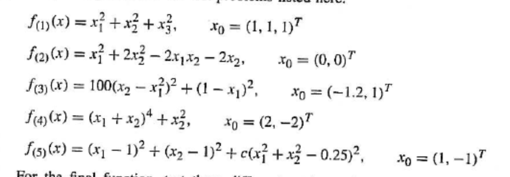

Illinois Institute of Technology
ECE 505 Project 1
Zubeda Patel A20532401

This repository contains 8 files.
Two files per method, one contains the algorithm and the other the results :
1. Steepest Descent Algorithm (steepest_descent.py), (steepest_descent.txt)
2. Newton's Algorithm (newtons_method.py), (newtons_method.txt)
3. Quasi-Newton Algorithm (BFGS) (Quasi_Newton_BFGS.py), (Quasi_Newton_BFGS.txt)
4. Conjugate Gradient Algorithm  (conjugate_gradient.py), (conjugate_gradient.txt) 

The results are derived from a testbench that runs the algorithms against the problem set provided:

All of the optimization methods implement the backtracking line search with Armijo's condition. 
It starts with ak = 1, then verfies armijo's condition :f(xk+akpk) > f(xk)+ c akpk^Tf'(xk). 
If True then ak = 1/2 ak otherwise otherwise ak = ak.
